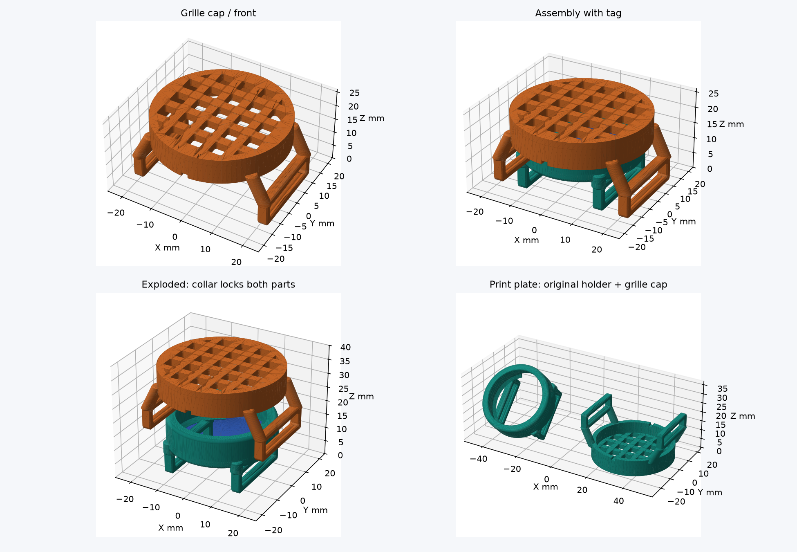

# Держатель Motorola Moto Tag для кожаного ошейника

**Новая конструкция V2:** [корпус с широкой задней опорой для метки 8,2 мм и обновлённая решётка](v2/README.md). Файлы V2 находятся в отдельной папке; приведённые ниже файлы в корне относятся к исходной версии V1.

**Аудит 20.10.2026:** основной корпус напечатан; пользователь сообщил утопление метки примерно 3,5 мм при высоте кольца 10,2 мм и толщине метки 8,2 мм. Найдены недостатки заднего удержания и несоответствие теста основному корпусу. Подробности и различия зазоров — [аудит модели](validation/MODEL_AUDIT_RU.md). Опубликованные STL/3MF пока сохраняют исходную геометрию. Настройки SCAD переведены: [русский справочник параметров](PARAMETRY_RU.md).

Параметрический держатель **Moto Tag первого поколения Ø31,9 × 8 мм** на ошейник **21,5 × 3,85 мм**, рассчитанный на **TPU 95A**. Есть исходный открытый корпус и вариант с наружной защитной решёткой, удерживаемой тем же ремнём.



## Скачать и напечатать

Готовые 3MF открывать в **Bambu Studio как проект**. Они настроены под **Bambu Lab A1 mini, сопло 0,4 мм, TPU 95A с внешней катушки**, масштаб 100%. Время и расход — расчёт слайсера, включая подготовку и поддержки.

| Вариант | Проект Bambu Studio | STL | Время / расход |
|---|---|---|---|
| Только защитная решётка к исходному корпусу | [3MF](moto_tag_collar_holder_grid_cap_TPU95A_A1mini.3mf) | [STL](moto_tag_collar_holder_grid_cap.stl) | 1 ч 37 мин / 8,11 г |
| Полный комплект с решёткой: две детали | [3MF](moto_tag_collar_holder_grid_TPU95A_A1mini.3mf) | [STL](moto_tag_collar_holder_grid.stl) | 2 ч 58 мин / 13,62 г |
| Исходный открытый корпус | [3MF](moto_tag_collar_holder_TPU95A_A1mini.3mf) | [STL](moto_tag_collar_holder.stl) | 1 ч 29 мин / 5,74 г |
| Тест посадки метки и ремня | [3MF](fit_test_TPU95A_A1mini.3mf) | [STL](fit_test.stl) | 42 мин / 3,81 г |

**Сборка решётки:** ремень продевается через все четыре замкнутых ушка — два корпуса и два накладки. Полная инструкция, проверка перед прогулкой и информация о дожде: **[GRID_README.md](GRID_README.md)**. Новая решётка прошла геометрическую проверку и слайсинг, но ещё не испытана физически; гарантированная удерживающая нагрузка не заявляется.

У самой метки заявлен IP67 с ограничениями производителя; напечатанный держатель не является герметичным футляром. Подробнее и ссылка на Motorola — в инструкции выше.

## Исходный корпус

**Вариант с наружной защитной решёткой:** добавлены отдельная накладка и комплект из двух деталей. Обе детали удерживаются одним ремнём через четыре замкнутых ушка. Файлы, сборка, печать и влагозащита описаны в [GRID_README.md](GRID_README.md); виды — `grid_preview.png`. Геометрия исходного держателя сохранена.

Одна печатная деталь из **TPU 95A**, два замкнутых ушка под краями кольцевой оправы, передняя упругая удерживающая кромка и задний открытый сектор для звука. Метка расположена параллельно ремню; клей, винты и отверстия в коже не нужны. Все размеры — мм.

**Тест посадки пройден 19.10.2026.** Пользователь напечатал тест и подтвердил: метка и ремень входят без люфта и без лишнего усилия. Позднее основной держатель тоже был напечатан; обнаружено более глубокое положение метки, чем в расчётной сборке. Усилие извлечения и удержание при нагрузке не измерялись. Подробности — в `validation/FIT_TEST_RESULT.md` и аудите выше.

## Файлы

| Файл | Назначение |
|---|---|
| `moto_tag_collar_holder.scad` | Полностью параметрическая основная модель |
| `moto_tag_collar_holder.stl` | Основной держатель, уже повёрнутый на 45° для печати с локальными поддержками |
| `fit_test.scad`, `fit_test.stl` | Полное тестовое кольцо и отдельный калибр ушка, две печатные детали |
| `fit_test_TPU95A_A1mini.3mf` | Настроенный и нарезанный тест посадки: A1 mini, 0,4 мм, TPU 95A, без поддержек |
| `moto_tag_collar_holder_TPU95A_A1mini.3mf` | Настроенный и нарезанный держатель: та же конфигурация, автоматические древовидные поддержки от стола |
| `bambu_presets/*.json`, `prepare_bambu.py` | Полные профили и воспроизводимая подготовка 3MF установленным Bambu Studio |
| `validation/BAMBU_CHECK.md` | Результат проверки слайсинга, время, расход и ограничения |
| `validation/FIT_TEST_RESULT.md` | Подтверждённая пользователем примерка напечатанного теста с реальной меткой и ремнём |
| `validation/bambu/*/toolpaths.png` | Виды фактических траекторий G-code: модель оранжевая, поддержки синие |
| `preview.png` | Виды фактически экспортированной сетки, сборка и ориентация |
| `validation/sections.png` | Геометрические сечения |
| `validation/geometry_report.json` | Численные результаты проверок |
| `validation/holder_installed.stl` | Та же основная сетка в положении на ошейнике; для осмотра |
| `validation/verify_model.py` | Воспроизводимая проверка и построение видов |
| `export_models.ps1` | Повторный экспорт после изменения параметров |

Исходный корпус цельный, с двумя замкнутыми ушками. Дополнительная решётка — отдельная деталь с собственными замкнутыми ушками, удерживаемая ремнём. Защёлки для установки без продевания ремня нет. Для монтажа нужно освободить конец ошейника; пряжка и толстое утолщение ремня через ушки не проходят.

## Готовые проекты Bambu Studio

Откройте сначала `fit_test_TPU95A_A1mini.3mf` как **проект**, чтобы загрузить его профили. Проверены A1 mini, сопло 0,4, масштаб 100%, TPU 95A, слой 0,20, 5 стенок, заполнение 40% gyroid, сопло 230 °C, PEI 35 °C, ограничение потока 2 мм³/с. Подача — внешняя катушка. Температуры являются стартовыми: сверяйте их с диапазоном своей катушки.

| Проект | Оценка Bambu Studio с подготовкой принтера | Оценка расхода |
|---|---:|---:|
| Тест посадки | 42 мин 8 с | 3,81 г |
| Основной держатель с поддержками | 1 ч 28 мин 38 с | 5,74 г |

Оценки получены Bambu Studio 02.08.02.61; фактическое время и масса зависят от катушки и принтера. После проверки реальной посадки печатайте основной держатель. Его поддержкам заданы `tree(auto)` / `tree_slim`, только от стола, Z-зазор 0,30 и XY-зазор 0,40 мм. Поддержки могут потребовать аккуратного разрезания при удалении; проверка траекторий не доказывает лёгкость отделения TPU от TPU. Перед установкой ошейника полностью освободите оба прохода и воздушный сектор.

На этапе подготовки основной 3MF был открыт в Bambu Studio как проект и повторно нарезан. Позднее пользователь получил напечатанный корпус; результат примерки описан в аудите от 20.10.2026. В экспортированных метаданных имеется уведомление о неподдерживаемом обычном таймлапсе; оно не является ошибкой геометрии. Таймлапс для этой пробной печати не нужен.

## Размеры и принятые решения

| Параметр | Значение |
|---|---:|
| Метка | Ø31,9 × 8,0 |
| Ошейник | 21,5 × 3,85 |
| Полость по максимальному диаметру | Ø32,3 |
| Радиальный зазор по цилиндрическому поясу | 0,20 с каждой стороны |
| Общий осевой запас | 0,40 |
| Минимальное отверстие удерживающих кромок | Ø29,5 |
| Наружный диаметр оправы | Ø36,3 |
| Высота самой оправы | 10,2 |
| Основная стенка кольца / ушек | 2,0 / 2,0 |
| Длина каждого ушка вдоль ремня | 3,2 |
| Расстояние между центрами ушек | 25,0 |
| Проход ушка до мягких рёбер | 22,3 × 4,45 |
| Минимальный просвет между вершинами рёбер | 3,95 |
| Габариты установленного держателя | примерно 36,3 × 36,3 × 19,32 |
| Высота над верхом прохода ремня | 12,87 |
| Задняя сторона метки — прямой ремень, худшее положение в проходе | 3,77 |
| Расчётный минимальный радиус изгиба внешней поверхности ремня | 40 |
| Оставшийся воздушный зазор после расчётного изгиба | 1,20 |

Полная высота 19,32 отсчитывается от нижней поверхности ушек, проходящей под ремнём. При среднем положении реального ремня высота над его внешней стороной немного больше табличной: примерно 13,17. Это не «толщина над кожей» 19,32.

Ушки расположены внутри проекции оправы. Два коротких участка по 3,2 мм ограничивают ремень, между ними нет сплошного основания. Четыре округлые стойки соединяют ушки с кольцом. Они заходят в верхнюю часть ушек на 1,2 мм; корни, выступающие внутрь оправы, вычтены общей полостью метки. На стойках есть фаски 0,35; наружные кромки кольца и профиля ушек скруглены радиусом 1,0. У входов ушек сняты фаски 0,35. Локальная толщина у самой фаски меньше номинальной стенки 2,0; это короткая обработка входа, а не отдельная тонкая перемычка.

### Скругление метки и удержание

Наружный размер 31,9 не означает цилиндр Ø31,9 по всей толщине. Принят радиус края `predpolagaemoe_skruglenie_metki=0.8`; точного профиля Motorola нет. Поэтому `radialnoe_suzhenie_bortika=0.6` отсчитывается внутрь **от предполагаемого радиуса плоской стороны**, с учётом радиального зазора:

`throat_radius = diametr_metki/2 + bokovoy_zazor_metki - predpolagaemoe_skruglenie_metki - radialnoe_suzhenie_bortika`.

Получается горло Ø29,5. Отношение Ø31,9 к Ø29,5 соответствует примерно 8,14% расширения по максимальному поясу. Это геометрическая оценка растяжения; она не определяет усилие, ресурс или допустимую нагрузку. При установке TPU выворачивается локально, а не растягивается равномерно всей окружностью. Для PETG такая сплошная кромка не рассчитана.

Внутренние переходы — конусы 45°, без тонких защёлкивающихся лепестков. Передняя кромка непрерывная; в задней оставлен акустический сектор 50°. Минимальный сквозной диаметр открывает около 85,5% площади проекции диска спереди. Сзади два узких ушка проходят ниже поверхности метки; это не сплошная крышка.

### Изгиб ошейника

При радиусе 40 и половине пролёта 14,1 расчётная выпуклость ремня равна:

`sag = R - sqrt(R*R - 14.1*14.1) = 2.57`.

Эта величина автоматически прибавлена к запасу под меткой. Сверху остаётся 1,2 мм воздуха. Это расчёт огибающей между точками крепления, а не моделирование деформации прошитой кожи: короткие участки в ушках будут местами выпрямляться, а TPU — деформироваться. На примерке проверьте, что ремень свободно изгибается, а метка не касается кожи. Для радиуса меньше 40 задайте меньший `radius_izgiba_osheynika` и повторите экспорт: держатель станет выше. Радиус измеряйте по внешней стороне застёгнутого ремня, в месте установки.

Мягкие округлые рёбра высотой 0,25 сверху и снизу уменьшают свободный ход. Между ними остаётся 0,10 общего запаса относительно кожи толщиной 3,85. Это пассивное трение, оно не гарантирует неподвижность на мокрой коже. Острых зубьев нет. Если прошивка или утолщение цепляется, уменьшите `vysota_reber_prizhima` до 0,15 или 0; не проталкивайте ремень силой.

## Кнопка, звук, установка и извлечение

1. Напечатайте тест, уберите нити и заусенцы. Проверьте ушко на реальном ремне, включая шов.
2. На тестовом кольце вставьте метку задней стороной вниз: сначала один край, затем постепенно заведите противоположный под переднюю кромку. Давите на периферию корпуса, не на кнопку.
3. Убедитесь, что метка села полностью и не болтается. Снимите её, отгибая переднюю кромку наружу пальцем и выталкивая корпус сзади за край. Инструменты и рычаг по кнопке не нужны. Полное кольцо теста имеет непрерывную заднюю кромку, а основной корпус — вырез; величина различия усилий удержания не измерена.
4. Проденьте освобождённый конец ошейника через оба ушка **под меткой**. Более толстая пряжка не предназначена для прохода.
5. Вставьте метку кнопкой наружу. Поверните звуковое отверстие к широкому вырезу в задней кромке: это направление +Y, то есть в сторону бокового края ремня. Круглая посадка не задаёт угол автоматически. Подберите угол по самому отверстию, не по декоративному логотипу.
6. Запустите звук, сравните громкость с меткой вне держателя. Проверьте это на застёгнутом и изогнутом ошейнике. При заметном приглушении поправьте угол и проверьте воздушный зазор.
7. Для замены батарейки снимите ошейник с собаки, освободите держатель от ремня и извлеките метку вперёд, локально отгибая кромку. Крышку батареи обслуживайте на извлечённой метке.

Держатель не имеет перемычек над центральной кнопкой. Проверена свободная центральная зона Ø29 перед лицевой стороной. Это исключает нажатие самой геометрией держателя; внешний предмет всё равно может нажать открытую кнопку.

Звуковое отверстие не имеет опубликованных в использованном руководстве точных координат. Его фактическое совпадение с вырезом и уровень звука проверяются при установке. Положение выреза в исходнике допускается +Y или −Y, чтобы не ослаблять узлы стоек.

## Bambu Studio: A1 mini, сопло 0,4, TPU 95A

На этих настройках пользователь успешно напечатал и примерил тест посадки. Бренд и партия катушки не указаны; печать основного держателя с поддержками ещё не проверена физически.

| Настройка | Начальное значение |
|---|---|
| Принтер | Bambu Lab A1 mini, сопло 0,4 |
| Материал | Generic TPU с параметрами производителя катушки; для Bambu 95A HF — его штатный профиль |
| Масштаб | 100%, единицы мм |
| Ориентация основного STL | Уже наклонён на 45° вокруг X; сохранить, затем «опустить на стол» |
| Высота слоя / первого слоя | 0,20 / 0,20 |
| Стенки | 5, ширина линии около 0,42 |
| Верх / низ | 5 / 5 слоёв |
| Заполнение | 40% gyroid; тонкие стенки и так почти сплошные |
| Внешняя / внутренняя стенка | 20–25 / 25–30 мм/с |
| Первый слой | 15 мм/с |
| Объёмная скорость обычного TPU 95A | Начать с ограничения 2 мм³/с, повышать после калибровки |
| Ускорение | Около 500 мм/с² |
| Сопло | Обычно 230 °C как старт; соблюдать диапазон своей катушки |
| Стол | 35 °C как старт на PEI; свериться с катушкой и пластиной |
| Обдув | После первых слоёв около 40–60%, далее подбирать по нависаниям и спайке |
| Brim | Наружный 8 мм; убрать его полностью у входов ушек |
| Поддержки основного держателя | В готовом 3MF: tree(auto), tree_slim, только от стола, угол 35° |
| Отрыв поддержки | Начать с верхнего Z-зазора 0,25–0,30 и XY около 0,4; проверить на своём TPU |
| Подача | Внешняя катушка; обычный TPU 95A не подавать через AMS lite |

Основной STL **не предназначен для печати без поддержек**. При наклоне стенки проходов ремня образуют примерно 45° к столу, что сокращает трудные мосты. Однако нижняя дуга кольца начинается выше первых слоёв ушек: ей нужна опора. В готовом 3MF её поддерживает автоматически построенное дерево. В G-code подтверждено начало отдельного участка модели на Z=3,20 мм над поддержкой; другие отдельные участки на Z=4,40 также имеют опору. Проверка не нашла полностью новых неподкреплённых островков при растровом контроле 0,10 мм. При изменении ориентации или профиля пересмотрите поддержки заново. Не заполняйте поддержками весь проход ушек: TPU трудно отделять от самого себя. Встроенных одноразовых перемычек в STL нет.

Не используйте автоматическое «положить на грань» для основного STL: это уберёт подготовленный наклон. Расположение в сборочных координатах (`polozhenie_dlya_pechati=false`) предназначено для осмотра, а не для печати плашмя: под поднятой оправой и крышами ушек тогда потребуются большие поддержки.

`fit_test.stl` уже лежит плашмя: кольцо задней стороной на столе, калибр ушка — осью прохода вертикально. В нём нет акустического выреза, поэтому поддержки не нужны. Геометрия передней кромки, полости, входных фасок и рёбер совпадает с основной версией. Тест экономит ушки, стойки и поддержки, но сохраняет полное кольцо: короткий сектор не показал бы удержание замкнутой оправы.

Высушите материал по инструкции его производителя и печатайте из сухой подачи. Для **Bambu TPU 95A HF** официальный ориентир — 70 °C, 8 ч в сушильном устройстве с циркуляцией, сопло 220–240 °C, стол 30–35 °C. Эти режимы сушки не следует автоматически переносить на другую катушку или бытовую духовку. При высокой адгезии TPU используйте предусмотренный производителем пластины разделительный слой клея.

Наклон 45° распределяет нагрузку относительно слоёв и облегчает проходы, но не устраняет слабость межслойного соединения. Критичные зоны — четыре стойки, сопряжения с ушками и передняя кромка. Недоэкструзия, влажность и холодная печать здесь особенно нежелательны.

## Настройка посадки

Меняйте параметры в начале основного SCAD и экспортируйте оба STL заново; `fit_test.scad` использует те же модули. Не исправляйте посадку общим масштабированием в слайсере: это одновременно изменит проход ошейника.

| Симптом | Изменение |
|---|---|
| Метка болтается по максимальному поясу | `bokovoy_zazor_metki`: 0,20 → 0,10–0,15 |
| Корпус зажат по поясу | Увеличить `bokovoy_zazor_metki` шагом 0,05 |
| Слишком трудно завести край / снять | `radialnoe_suzhenie_bortika`: 0,60 → 0,45–0,50; снова испытать удержание |
| Кромка слишком легко отпускает корпус | `radialnoe_suzhenie_bortika`: 0,60 → 0,70, шагом 0,10; сначала тест |
| Скругление корпуса отличается | Уточнить `predpolagaemoe_skruglenie_metki`; проверить оба направления фиксации |
| Люфт по высоте | Проверить заднюю опору и профиль метки; `osevoy_pripusk_metki` меняет высоту кольца, но не равен свободному ходу. См. аудит |
| Кожа застревает | Сначала уменьшить рёбра, затем увеличить суммарный зазор по толщине |
| Ремень шире из-за прошивки | Увеличить `zazor_remnya_po_shirine` шагом 0,2 |
| Кожа выгибается и приближается к метке | Уменьшить `radius_izgiba_osheynika` или увеличить `zazor_nad_izognutym_remnem` |

Увеличение предполагаемого радиуса края при неизменном `radialnoe_suzhenie_bortika` уменьшает отверстие. Радиальный зазор 0,20 относится к поясу; зазор на наклонных участках другой. Boolean-проверка предполагаемого скруглённого диска прошла, но это не подтверждает неизвестный реальный профиль корпуса.

PETG, PLA и «TPU for AMS» другой твёрдости не являются заменой TPU 95A для этой геометрии. Жёсткий вариант потребовал бы другой защёлки, разделённого корпуса и отдельной проверки; такого STL здесь нет.

## Что проверено и что остаётся проверить

В OpenSCAD 2021.01 выполнен полный CGAL-рендер и экспорт. Для основной модели получен `Simple: yes`; в терминах CGAL число Volumes включает внешнюю пустую область, поэтому строка Volumes=2 соответствует одному твёрдому телу. Отдельная проверка сетки подтверждает одно связное тело, замкнутость, согласованное направление граней, положительный объём и приём в Manifold без ошибки. Тестовый STL имеет два отдельных замкнутых тела по назначению.

Проверены нулевые пересечения с предполагаемым скруглённым диском Ø31,9 × 8, прямым ремнём 21,5 × 3,85 и центральной зоной кнопки Ø29. Свободен боковой воздушный коридор к акустическому сектору. Учтена расчётная выпуклость ремня, но местное изгибание кожи и ушек не рассчитывалось методом конечных элементов. Горизонтальные сечения проверены с шагом 0,20; это проверка геометрии, не экспорт G-code. Отдельный полный попарный тест всех треугольников не выполнялся; опора для проверки корректности тела — CGAL-рендер и проверки топологии/Boolean.

**Проверка Bambu Studio выполнена 19.10.2026.** Причина прежней ошибки `invalid string position` устранена восстановлением повреждённого файла настроек. Оба STL успешно нарезаны версией 02.08.02.61; созданы редактируемые 3MF с профилями и вложенным G-code. Проверены настройки в архивах, контрольная сумма вложенного G-code и траектории начала отдельных участков модели. Основной проект открыт и повторно нарезан в интерфейсе. Полные результаты и границы проверки — в `validation/BAMBU_CHECK.md`. Посадка метки и ремня подтверждена на напечатанном тесте пользователем. Лёгкость удаления поддержек, сборка основного держателя, прочность и звук ещё требуют физической проверки.

До эксплуатации проверьте вне собаки: полную посадку, несколько циклов установки/снятия, ручное вытягивание за разные края, встряхивание и смачивание ошейника. После этого осмотрите стойки и слои. Метка не должна выходить без сознательного отгибания кромки. Если выходит, подберите посадку и повторите тест. Значение гарантированной удерживающей нагрузки не заявляется. Держатель не является силовой частью ошейника для поводка.

## Повторный экспорт

Из PowerShell в этой папке:

```powershell
.\export_models.ps1
```

Скрипт использует переносной OpenSCAD из `.tools/openscad-2021.01` или установленный `openscad.com`/`openscad`. Подкаталог `.tools` содержит загруженные инструменты и библиотеки проверки; для импорта готового STL в Bambu Studio он не требуется. Для повторной проверки Python нужны numpy, trimesh, manifold3d и matplotlib; в текущем проекте они находятся в `.tools/python_libs`.

Локальные инструменты `.tools` в GitHub не включены. После клонирования установите OpenSCAD 2021.01 и добавьте его CLI в `PATH`; зависимости проверок установите командой `python -m pip install -r requirements.txt`. Для пересоздания 3MF скрипт ожидает Bambu Studio в `C:\Program Files\Bambu Studio`. Для повторного экспорта решётки используйте `export_grid.ps1`; остальные команды приведены в [GRID_README.md](GRID_README.md).

После изменения STL пересоздайте 3MF и проверьте траектории:

```powershell
python .\prepare_bambu.py
python .\validation\inspect_bambu.py
```

`prepare_bambu.py` использует установленный `C:\Program Files\Bambu Studio`, раскрывает наследование штатных профилей и включает штатные шаблоны стартового/конечного G-code A1 mini. Скрипт не соединяется с принтером и не отправляет задание. Для второй команды используются локальные numpy, Pillow и matplotlib из `.tools/python_libs`.

## Первичные источники

- [Motorola: руководство moto tag первого поколения](https://en-us.support.motorola.com/app/answers/detail/a_id/181324/~/user-guide---moto-tag) — размеры, кнопка, крышка и звуковое отверстие; рекомендация открытых сторон.
- [Bambu Lab: TPU 95A HF](https://kr.store.bambulab.com/products/tpu-95a-hf) — режимы материала и ограничения подачи.
- [Bambu Lab: официальный справочник материалов](https://cdn1.bambulab.com/filament/filament-guide/250123/filament-guide-en.pdf).
- [OpenSCAD: официальная загрузка](https://openscad.org/downloads.html). SHA256 скачанного архива совпал с опубликованным: `fb0caabf5bbc89f8f2f80c10b79ae64d697aaff6efd58b2756f5d6270edb7ba7`.
- [Bambu Studio: официальный интерфейс командной строки](https://github.com/bambulab/BambuStudio/wiki/Command-Line-Usage) — подготовка полных профилей и экспорт нарезанного 3MF.
