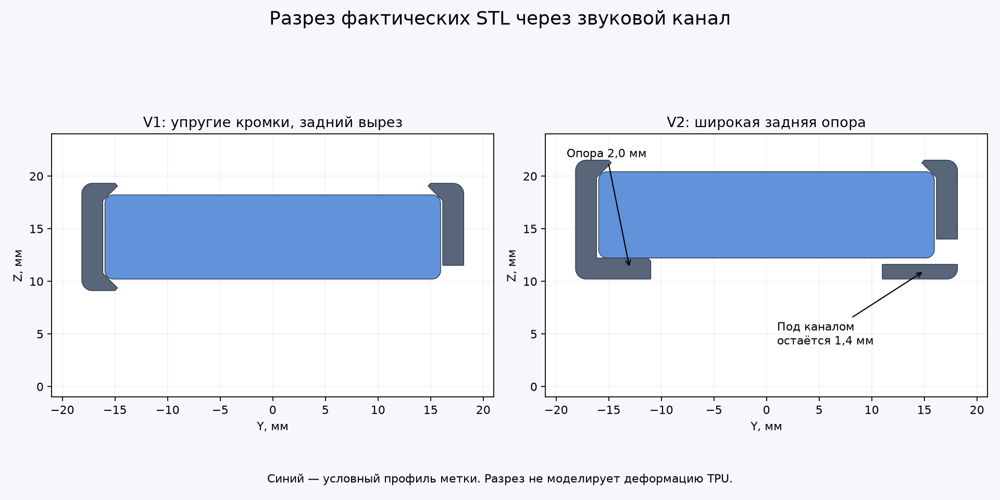
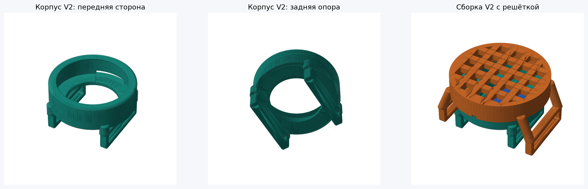

# Держатель Moto Tag V2 — с задней опорой

Версия от 20.10.2026 после примерки V1: измеренная толщина метки 8,2 мм, утопление в прежнем корпусе около 3,5 мм. Причины и ограничения прежней геометрии разобраны в [аудите V1](../validation/MODEL_AUDIT_RU.md).

В V2 глубину задаёт **широкая кольцевая задняя опора толщиной 2,0 мм**. Центральное отверстие — Ø22 мм, с фаской 0,3 мм со стороны метки. Под звуковым каналом сохраняется 1,4 мм пластика: опора больше не разрезана насквозь. Диаметр посадки и проходы ремня сохранены после успешной примерки V1.

## Что печатать

Сначала открыть **[корпус V2 — 3MF](moto_tag_collar_holder_v2_TPU95A_A1mini.3mf)** как проект Bambu Studio. Этот корпус одновременно является проверочной деталью и частью окончательной сборки. Отдельное тестовое кольцо не требуется.

| Деталь | Проект Bambu Studio | STL |
|---|---|---|
| Корпус V2 — первая примерка | [3MF](moto_tag_collar_holder_v2_TPU95A_A1mini.3mf) | [STL](moto_tag_collar_holder_v2.stl) |
| Накладка с решёткой V2 | [3MF](moto_tag_collar_holder_grid_cap_v2_TPU95A_A1mini.3mf) | [STL](moto_tag_collar_holder_grid_cap_v2.stl) |
| Корпус и накладка V2 на одном столе | [3MF](moto_tag_collar_holder_grid_v2_TPU95A_A1mini.3mf) | [STL](moto_tag_collar_holder_grid_v2.stl) |

Оценки Bambu Studio с подготовкой, каймой и поддержками:

| Вариант | Время | TPU |
|---|---:|---:|
| Корпус V2 | 1 ч 43 мин | 7,15 г |
| Накладка V2 | 1 ч 40 мин | 8,27 г |
| Полный комплект | 3 ч 14 мин | 15,31 г |

Все проекты рассчитаны на A1 mini, сопло 0,4 мм, TPU 95A с внешней катушки, масштаб 100%. Слой 0,20 мм, 5 стенок, заполнение 40%, сопло 230 °C, стол Textured PEI 35 °C, ограничение потока 2 мм³/с — профиль предыдущей успешной печати. Корпус наклонён на 45°, решётка лежит лицевой стороной на столе. Поддержки включены в обоих случаях. Автоматически менять ориентацию деталей не нужно.

Скрипт `fit_test_v2.scad` вызывает тот же модуль полного корпуса с той же ориентацией, а не облегчённую копию. Для печати теста используется **тот же 3MF корпуса** с поддержками.

## Что изменилось в размерах

| Размер | V1 | V2 |
|---|---:|---:|
| Расчётная толщина метки, мм | 8,0 | 8,2 |
| Высота кольца, мм | 10,2 | 11,3 |
| Полная высота корпуса с ушками, мм | 19,32 | 21,52 |
| Утопление передней поверхности условной метки, мм | 1,1 | 1,1 |
| Отверстие задней опоры, мм | Упругая кромка Ø29,5 с вырезом | Ø22,0; Ø22,6 у верхней фаски |
| Толщина задней опоры, мм | Отдельной широкой полки нет | 2,0; под звуковым каналом 1,4 |
| Полная высота накладки с ушками, мм | 23,12 | 25,32 |

Нижняя поверхность новой опоры поднята над расчётным изгибом ошейника на 1,2 мм. Поэтому корпус стал выше: добавление полки внутрь прежнего габарита создало бы пересечение с изогнутым ремнём. Задняя опора имеет примерно 3,85 мм радиального перекрытия с плоской частью условного профиля после фаски. Реальный профиль метки не измерялся, поэтому площадь реального контакта может отличаться.

**Корпус и накладку следует брать одной версии.** У V2 выше положение метки и решётки; прежняя накладка V1 не проверена с новым корпусом и не считается совместимой.

## Примерка и сборка

1. Удалить поддержки с корпуса, в том числе из проходов ремня, центрального отверстия и звукового канала. Полку толщиной 2 мм оставить: она часть модели, а не поддержка.
2. Вставить метку спереди кнопкой наружу, заведя край под упругий передний бортик. Метка должна опираться на заднюю полку. Давить на край корпуса метки, не на кнопку.
3. Проверить, что метка не проваливается за опору, ремень проходит свободно, а кнопка доступна. Заявленные 1,1 мм относятся к условной крайней передней плоскости; положение большой синей поверхности может отличаться из-за формы корпуса метки.
4. После примерки установить накладку V2 и продеть ремень через все четыре замкнутых ушка — два корпуса и два накладки. Звуковое отверстие метки направить к каналу на стороне +Y.
5. Перед использованием проверить удержание вне собаки. Новая геометрия пока не прошла физическую примерку и испытание усилия извлечения.

Для извлечения снять держатель с ремня, отогнуть переднюю кромку и вытолкнуть метку за корпус через центральное отверстие сзади. Герметичности держатель не добавляет: центральное отверстие, звуковой канал и решётка открыты; сведения о влагозащите самой метки приведены в [общей инструкции](../GRID_README.md).

## Настройки OpenSCAD

- [Корпус](moto_tag_collar_holder_v2.scad): размеры метки и ремня, опора и положение при печати.
- [Решётка](moto_tag_collar_holder_grid_v2.scad): параметры накладки. `vid_modeli`: `stol`, `nakladka`, `nakladka_v_sborke`, `sborka`.
- [Проверочная деталь](fit_test_v2.scad): тот же полный корпус; размеры редактируются в основном исходнике.

Группы и пояснения на русском, имена транслитом. Новые настройки:

| Параметр | Значение | Значение настройки |
|---|---:|---|
| `tolshchina_metki` | 8,2 | Измеренная полная толщина метки |
| `utoplenie_metki_speredi` | 1,1 | Высота края над условной передней поверхностью |
| `tolshchina_zadney_opory` | 2,0 | Толщина опоры до её верхней плоскости |
| `diametr_zadnego_otverstiya` | 22,0 | Диаметр центрального отверстия |
| `faska_zadnego_otverstiya` | 0,3 | Верхняя фаска центрального отверстия |
| `glubina_zvukovogo_kanala` | 0,6 | Углубление канала в опору |
| `zazor_nad_izognutym_remnem` | 1,2 | Зазор до нижней стороны опоры при расчётном изгибе ремня |

Параметры V1 `osevoy_pripusk_metki` и `osevaya_dobavka_bortika` в V2 удалены: положение метки задаётся поверхностью опоры, высота переднего края — отдельной настройкой. Остальные настройки описаны рядом со своими значениями в SCAD.

## Воспроизводимость и границы проверки

`python v2/build.py --stage all` экспортирует модели, проверяет геометрию, создаёт проекты Bambu Studio и проверяет файлы печати. Для отдельных этапов доступны `export`, `verify`, `slice`, `audit`. Требуются OpenSCAD, установленный Bambu Studio с профилями A1 mini и Python-зависимости из корневого `requirements.txt`; локальная папка библиотек `.tools/python_libs` также поддерживается.

Проверка использует фактические STL: замкнутость, связность, отсутствие пересечений сборки, непрерывность задней опоры под звуковым каналом, остановку условной метки при смещении назад, свободный звуковой канал и зазор до ремня. Дополнительно сравниваются отдельные детали с комплектом на столе. Хеши исходников и экспортов предотвращают проверку устаревших файлов.

**Результат 20.10.2026:** все геометрические проверки пройдены. Три проекта успешно нарезаны; целостность архивов и контрольные суммы G-code проверены. Встроенные сетки согласуются со своими STL, преобразования сохраняют масштаб 100%. Растровый анализ фактических траекторий всех трёх проектов не обнаружил целых новых участков модели без предыдущего слоя или близкой поддержки. Разрешение проверки 0,1 мм, допуск по XY 0,5 мм, история поддержек 0,75 мм; это не проверка каждого локального нависания и не гарантия лёгкого удаления поддержек.

Численные результаты: [геометрия](validation/geometry_report.json), [слайсинг](validation/slicing_report.json), [сетки внутри 3MF и траектории печати](validation/print_checks.json). Условный профиль метки имеет предполагаемое скругление 0,8 мм. Проверка устанавливает наличие геометрического упора, но не предсказывает деформацию TPU, усилия, износ, громкость звука и положение реальной кнопки. Печать автоматически не запускается.
